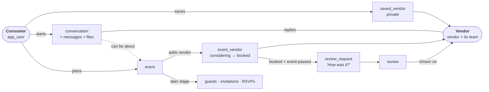
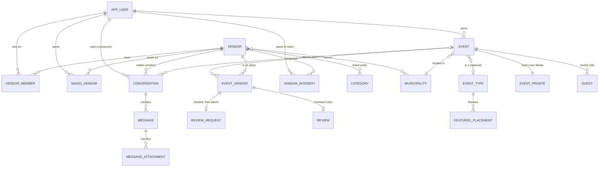
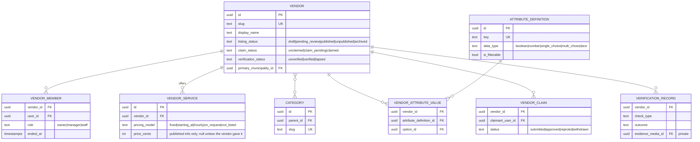
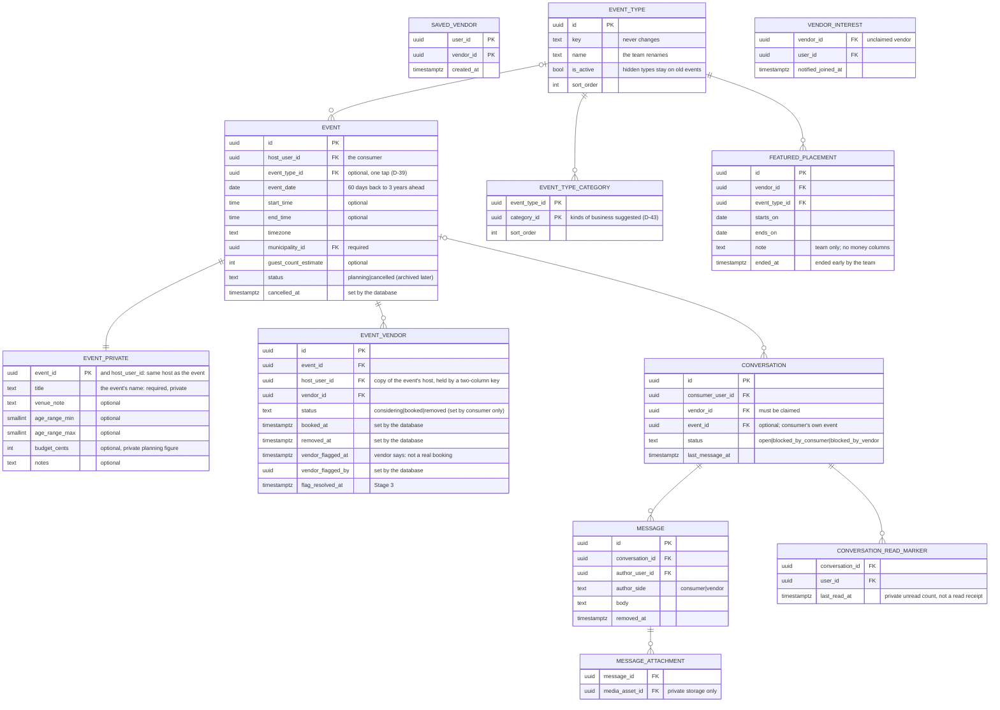
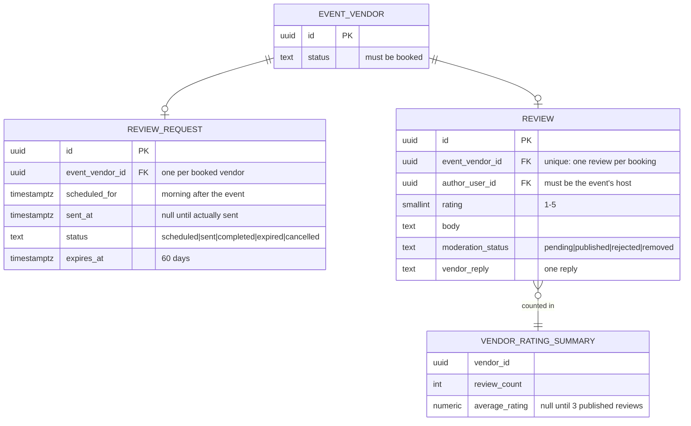
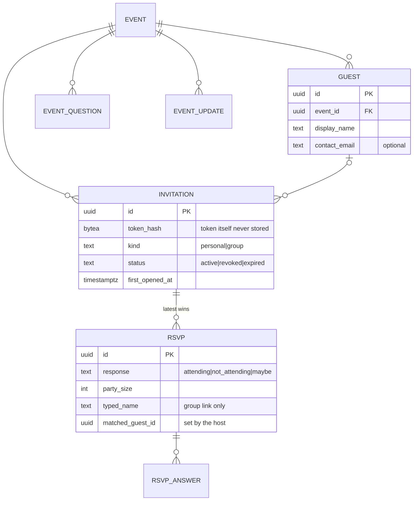

# B — Domain & Data Model

**Status:** Approved (D-00, 10 October 2026).
**Last updated:** 2026-10-13 (events, plans and saves built in migration 0012: §3.3, §3.6, §4, §6 and §8; earlier: claims state machines, `sign_in_code_event`, `notification` in Stage 1)

**Revision 2:** reworked around the two users, consumer and vendor, and the
relationship between them. The commercial domain (quotes, vendor-confirmed bookings,
agreements, payments) has been removed: Localites is the digital handshake, never a party
to the deal. Messaging with file sharing is now central. "Booked" is the consumer's own
record, and it drives post-event feedback and reviews. Plain-English version:
[roles-and-relationships.md](./roles-and-relationships.md).

This is the most important document in the set. If the data model is right, features
can be added for years. If it is wrong, every feature after the mistake inherits it.

---

## 1. Rules that apply to every table

These are decided now because changing them later means touching every table.

| Rule | What it means | Why |
|---|---|---|
| **Stable identity** | Every record has a permanent `id` (UUID v7). It never changes and is never reused. | A vendor is the same vendor whichever screen you reach it from. UUIDs also can't be guessed by incrementing a number in the address bar. |
| **Public addresses are separate from identity** | Vendors also have a readable `slug` (`/vendors/lakeside-face-painting`). Slugs can change; old ones redirect. | Links shared on Facebook keep working after a business renames itself. |
| **One source of truth** | A fact is stored in exactly one place. Other records point to it; they don't copy it. | No conflicting versions of a vendor's name or an event's date. |
| **Nothing important is hard-deleted** | Relationships end with a status and a timestamp, not a `DELETE`. | History survives when a vendor is removed from an event. |
| **Real deletion exists for personal data** | When a person deletes their account, personal fields are erased or anonymised. | Privacy law and basic decency. See [E §7](./E-security-and-privacy-model.md#7-retention-and-deletion). |
| **Every status change is recorded** | Changes write a `status_change` row: who, when, from, to, why. | We can always answer "when was this marked booked, and by whom?" |
| **Each status has one owner** | Every status field says *who* is allowed to set it (consumer, vendor, platform, or system). | "Booked" is the consumer's word; it can never be set by anyone else. |
| **Time** | Stored in UTC. Events store their date, optional times, and local time zone. | Correct times across daylight saving, and ready for other regions. |
| **Money** | Only appears as a vendor's *published* price information, in integer cents. No transaction, payment, or balance fields exist anywhere. | Localites never handles money (ADR-018). |
| **Place** | Every vendor and event is tied to a real `municipality`, not just free text. | Expansion to new towns is adding rows, not rewriting search. |
| **Reference data, not code** | Event types, categories, places, attribute definitions live in admin-editable tables. | Adding "baby shower" or "Barrie" doesn't need a developer. |
| **Ownership on every row** | Every private record traces to its owner (a consumer, a vendor team, or the platform) in one step. | Permission checks are simple and auditable. |

## 2. The two users and the records between them



| Record | What it is | Owned by |
|---|---|---|
| `app_user` | A person with an account. Every account is a **consumer** by default. | Themselves |
| `vendor` | A local business. One record per business, forever. | The platform until claimed; then the vendor's team |
| `vendor_member` | A person on a vendor's team (owner, manager, staff). This is what makes someone act **as a vendor**. | The vendor's owner |
| `saved_vendor` | A consumer's private bookmark of a vendor | The consumer |
| `event` | Something a consumer is planning | The consumer (host) |
| `event_vendor` | A vendor on a consumer's event plan, with the consumer's status: considering → booked | The consumer |
| `conversation` | The handshake: one consumer and one vendor talking, optionally about one event | Both, jointly |
| `message`, `message_attachment` | What they say and share | The author |
| `review_request` | Localites asking the consumer how it went | The platform |
| `review` | The consumer's rating and comments, and the vendor's one reply | Consumer (review), vendor (reply), platform (publication) |

**Why there's no "consumer" table.** A consumer isn't a separate kind of account. It's
any person acting on their own behalf. A person becomes able to act *as a vendor* only
through `vendor_member`. This is how one person can wear both hats (D-13) without two
logins, and without any screen ever confusing the two.

## 3. Entity-relationship diagrams

Stage badges: **[S1]** discovery & vendors, **[S2]** the handshake, **[S3]** feedback &
reviews, **[S4]** guests & RSVPs (stage order is decision D-14).

### 3.1 The whole picture



### 3.2 Discovery & vendor — [S1]



Full Stage 1 detail, including service areas, media, collections and the audit tables,
is in [db/migrations/0001_stage1_foundation.sql](../db/migrations/0001_stage1_foundation.sql) (built from the reviewed [proposal](./schema/stage1-proposed.sql)).

### 3.3 The handshake: events, plans, conversations — [S2]

**Events, plans and saves are built** (migration
[0012_event_plans.sql](../db/migrations/0012_event_plans.sql), ADR-031). Conversations,
messages, files and inquiries are still proposed
([schema/stage2-3-proposed.sql](./schema/stage2-3-proposed.sql)).



**Who sees what (as built, ADR-031).** The event's name, where it is, the ages, the budget
and the notes live in `event_private`, which only the host can read: never a business, never
the team. A business marked **booked** sees the person's name, the date, the town and about
how many guests (D-40). The team sees only flagged bookings, and featured placements and
suggestions it manages. Saves are seen only by the person who saved; the team sees totals
(D-42). The kind of event is optional and is used only for ideas on the person's own plan and
the team's totals; a business never sees it.

### 3.4 Feedback & reviews — [S3]



`VENDOR_RATING_SUMMARY` is calculated from published reviews, never stored or typed in.

**A review is chained to a booking:** `review → event_vendor (status = booked) → event
(date passed) → host`. The database refuses a review that breaks any link in that
chain. See the proposed SQL in
[schema/stage2-3-proposed.sql](./schema/stage2-3-proposed.sql), which now applies on top of
the built migrations 0001–0012 (the event part moved into 0012).

### 3.5 Guests & RSVPs — [S4]



Guests are **not users**: they never have accounts and never interact with vendors.
Invitation-link security is in [E §5](./E-security-and-privacy-model.md#5-invitation-link-security).

### 3.6 Changes from the 10 October 2026 decisions

Stages are unchanged.
- **Inquiries** (D-04, D-05, ADR-024, Stage 2): `vendor_interest` gains an optional note,
  an optional event, and the status of the email to the Localites team.
- **Activity tracking** (D-22, ADR-023): `activity_event` (detail, no deletion date) and
  `vendor_daily_stats` (daily totals, kept) replace the planned `analytics_event`. Both are
  built in Stage 1 and record what exists then (seen in search, profile views, website
  and phone taps); saves, inquiries, conversations and messages are added in Stage 2.
  Detailed records have no deletion date (D-22, amended); they're unlinked from anyone
  who deletes their account, and older ones move to archive storage if the database
  nears its free limit.
- **Reviews** (D-06, option B): no conversation required. `review.planned_on_localites`
  is set by the database (did the vendor reply to the host on Localites?) and can't be
  changed; false shows "Planned outside Localites". Checked in the proposed schema.
- **Events** are kept for as long as the host's account exists (D-10). Guest names and
  replies stay; guest phone numbers and emails are erased 90 days after the event.
- **Invitations** (D-08): `invitation.kind` is `personal` (one guest) or `group` (shared
  in a group chat, on social media or as a QR code). A reply through a group link carries
  the name the guest typed; the host matches it to a `guest`, so "not replied yet" stays
  accurate.
- **Suggested businesses** (D-25, ADR-027, Stage 1): `vendor_suggestion` holds the name,
  website and phone or email someone gave, which category or search they were on, who
  suggested it if signed in (from Stage 2), its status (new, added, declined, duplicate),
  the vendor it became, and whether the team email was sent.
- **Paid vendor plans** (D-24, ADR-025): `vendor_plan` records a vendor's plan and its
  start and end dates, set by an admin. Vendors pay outside Localites; no prices or
  payment details are stored.

**Built 12–13 October 2026 (migration 0012, D-39 to D-43):**
- **Events:** the town is required; the kind of event is optional; the event's name is
  required and private (`event_private.title`). A business never sees the name or the kind.
- **Plans:** `event_vendor` copies the host's id (held to the event by a two-column key) so
  the per-person rules never loop; the database sets every time and writes `status_change`.
  The flag columns gain who flagged it, a team-only note, and room for Stage 3's decision.
- **Ideas per kind of event (D-43):** `event_type_category` (the kinds of business suggested
  for each kind of event) and `featured_placement` (a business the team features for a kind
  of event between two dates; no money columns).
- **Team-only counts (D-42):** two database functions add up saves, adds and bookings per
  business and per kind of event; nothing new is stored for them.
- **Notifications:** three more kinds: `booked_event_cancelled`, `booked_event_changed`
  (to the business) and `booking_flagged` (to the person, D-41).

## 4. Lifecycle states and what they do NOT mean

User-facing wording must match the "means" column and must never imply the "does not
mean" column.

| Moment | Where it lives | Set by | It means | It does **not** mean |
|---|---|---|---|---|
| Appears in search | Calculated live | — | Listing is published and matches | Endorsed or available |
| Saved | `saved_vendor` | Consumer | A private bookmark | Any contact. The vendor isn't told. |
| Conversation started | `conversation` + first `message` | Consumer | The consumer wrote to the vendor through Localites | The vendor has read or replied |
| Vendor replied | `message` with `author_side = vendor` | Vendor | A reply exists | Availability or agreement |
| File shared | `message_attachment` | Either | A file was sent in the conversation | Anything about its contents. Localites doesn't read or act on files. |
| Added to event | `event_vendor.status = considering` | Consumer | The consumer is considering this vendor | Contacted or booked. The vendor isn't told. |
| Booked | `event_vendor.status = booked` | Consumer | **The consumer says** they've booked this vendor | That Localites or the vendor confirmed it, or that money moved |
| Booking flagged | `event_vendor.vendor_flagged_at` | Vendor (owner or manager) | The vendor says this booking isn't right. The team and the person are told (D-41); the note stays with the team | That it isn't; the platform team resolves it (Stage 3) |
| Feedback requested | `review_request.status = sent` | System | An email was actually sent (or the in-app prompt shown) | That it was read |
| Review submitted | `review.moderation_status = pending` | Consumer | Awaiting the platform team's check | Published |
| Review published | `review.moderation_status = published` | Platform | Passed the review policy and is public | Localites endorses the vendor or the opinion |

### State machines

Only these transitions are allowed; anything else is rejected by the server (ADR-017).

**`event.status`** — consumer only. Built (0012).
```
planning → cancelled   (final in 2A; businesses marked booked are emailed)
planning → archived    (reserved; not offered yet)
```
A cancelled event can't be changed, and nor can its plan.

**`event_vendor.status`** — consumer only. Built (0012): enforced by the database, which also
sets `booked_at`/`removed_at` and writes `status_change`.
```
(new)       → considering  (consumer adds a published business; it isn't told)
considering → booked       (consumer marks booked; vendor is notified)
booked      → considering  (consumer un-marks; vendor is notified; any pending feedback request is cancelled)
considering → removed      (row kept, removed_at set)
booked      → removed      (row kept; vendor is notified)
removed     → considering  (consumer re-adds the same vendor; same row, history kept)
```
A business the person is on the team of can't be added or marked booked on their own event.
A business not yet on Localites (unclaimed) can be added and marked booked; nobody is told
and nothing is kept for later.

**`event_vendor.vendor_flagged_at`** — the business (owner or manager) only, once, and only
while it's marked booked. Deciding on it (`flag_outcome`) is Stage 3.

**`conversation.status`**
```
open → blocked_by_consumer   (consumer blocks)
open → blocked_by_vendor     (vendor owner/manager blocks)
blocked_* → open             (only the side that blocked can unblock)
```

**`review_request.status`** — system only.
```
scheduled → sent → completed
    ↓        ↓
cancelled  expired   (after 60 days, or if the booking is un-marked or flagged)
```

**`review.moderation_status`** — platform only (except the consumer submitting).
```
pending → published → removed   (removed only for a policy breach, with reason)
pending → rejected              (with reason shown to the author)
```

**`vendor.listing_status`** — unchanged from revision 1.
```
draft → pending_review → published ⇄ unpublished → archived
```

**`vendor_claim.status`** — the claimant submits; only the platform team decides (ADR-028).
```
submitted → approved   (team, with how it was confirmed; never their own claim)
submitted → rejected   (team, with a reason emailed to the claimant; or automatically,
                        when another claim for the same business is approved: D-35)
submitted → withdrawn  (reserved; not offered yet)
```

**`vendor.claim_status`** — follows the claims, in the same transaction.
```
unclaimed     → claim_pending   (first claim submitted)
claim_pending → claimed         (a claim approved: the claimant becomes the one active owner)
claim_pending → unclaimed       (the last waiting claim declined)
```
Claimed doesn't mean verified: verification is its own check with recorded evidence.

**`invitation.status`** — Stage 4, unchanged. Opening a link is recorded separately
from RSVPing.

## 5. Metadata strategy

Unchanged from revision 1.

**Tier 1, real columns:** anything that drives behaviour, permissions or lifecycle.
**Tier 2, typed attributes:** admin-managed filters (`attribute_definition`,
`attribute_option`, `vendor_attribute_value`). An admin adds a filter without a
developer, and values are validated by type. **Tier 3, display-only extras:** a small
JSON field for things never filtered on. A database check prevents a Tier 2 key from
hiding there.

| To add… | You do… | Developer needed? |
|---|---|---|
| A category or subcategory | Admin → Categories → Add | No |
| An event type ("Retirement party"), its suggested kinds of business, or a featured business for it | Admin → Event types (built) | No |
| A filter ("Offers gluten-free") | Admin → Attributes → Add | No |
| A town | Admin → Places → Add | No |
| A new **core** field | Migration + code | Yes, by design |

## 6. Relationship semantics

| Relationship | Cardinality | What ending it means |
|---|---|---|
| Person ↔ Vendor team (`vendor_member`) | many-to-many, with role | Ended, not deleted. Past messages stay attributed to the business. |
| Consumer → Event | one host, many events | Cancelling sets status and is final; businesses marked booked are emailed. A change of date or town is also emailed to them (every real change; at most 30 planning emails a day to anyone). |
| Event ↔ Vendor (`event_vendor`) | one row per event+vendor pair | Removing sets `removed`; re-adding reuses the row. History in `status_change`. |
| Consumer ↔ Vendor (`conversation`) | at most one general conversation per pair, plus at most one per event | Blocking closes it for both; nothing is deleted. |
| Conversation → Event | optional; can be linked later | Proposed: the vendor sees only the event's date, town and guest-count estimate (D-40 removed the kind of event for bookings; the same is expected for conversations). |
| Event ↔ Vendor → Review | at most one | Enforced by the database. |
| Consumer ↔ unclaimed Vendor (`vendor_interest`) | one per pair | When the vendor claims, the consumer is told they can now message them. |

## 7. Future changes we already know about

| Possible future need | Path |
|---|---|
| A business with several listings, or non-vendor organisations | Add `organization` above `vendor`; no vendor IDs change. |
| Households (co-parents planning together) | Add `household`; events gain an optional household. Conversations stay one consumer ↔ one vendor. |
| Co-hosts on an event | Add `event_collaborator`; conversations remain the host's unless shared explicitly. |
| "Within 30 km" search | Coordinates are already stored on places; add a vendor base location and radius. |
| A search service at scale | Fed from PostgreSQL, which remains the source of truth. |
| Vendors sending structured price estimates | Could be added as a message *type* inside a conversation. It would remain information between the two parties, never a transaction. |
| Vendor subscriptions or sponsored placements | `entitlement` and `placement` keyed on `vendor_id`, clearly labelled. They never affect reviews or ratings. |
| Payments | **Not planned.** Nothing in the model assumes or prepares for them. It would be a new decision, a new domain, and a change to the terms of use. |

## 8. Table catalogue

| Table | Domain | Stage | Purpose |
|---|---|---|---|
| `app_user` | People | S1 | Anyone with an account. A consumer by default. Name shown everywhere (`display_name`), and since D-36 the first and last name as typed (`given_name`, `family_name`: both or neither; older team accounts have neither until saved). |
| `person_profile` | People | S1 | Details a person chose to give at sign-up or on Your account (D-36): gender (or their own words), date of birth, street address, unit, town, province, postal code. None required; no row when none given. Never shown to businesses. |
| `platform_role` | People | S1 | Grants `admin` to the platform team. |
| `municipality`, `category`, `attribute_*` | Reference | S1 | Places, taxonomy, typed filters |
| `vendor` + `vendor_*` | Vendor | S1 | The business, its team, services, areas, attributes, media, links, slugs |
| `vendor_claim`, `verification_record` | Vendor | S1 | Ownership claims (how the claimant is connected, their note, the team's decision and reason); evidence-backed checks |
| `owner_change` | Vendor | S1 | The team's review state for each owner save (ADR-029): flags ("new website", "new phone"), whether the "check now" email went, which daily note listed it, and whether and how it was undone. What changed lives only in `audit_log`. |
| `team_digest` | Operations | S1 | One row per day for the team's daily note of owners' changes: sending, sent, failed (with why) or nothing to report. |
| `sign_in_code_event` | People | S1 | Our limits on emailed sign-in codes (ADR-028): a SHA-256 fingerprint of the address (not the address), "sent" (a code was asked for) or "wrong code" (a guess, removed again if it was right), and when. Rows older than two days are removed as new codes are asked for. |
| `media_asset` | Media | S1 | Every stored file, with owner and visibility |
| `collection`, `collection_item` | Discovery | S1 | Curated lists |
| `status_change`, `audit_log` | Audit | S1 | Append-only history |
| `activity_event` | Analytics | S1 | One meaningful action on a vendor (profile view and source, tap; from Stage 2 save, inquiry, conversation, message): time, vendor, person or visitor ID. Kept with no deletion date (D-22, ADR-023). |
| `vendor_daily_stats` | Analytics | S1 | Per vendor, day, placement and town: seen in search, views, taps (from Stage 2 also saves, inquiries, conversations, messages), unique people. Kept. |
| `vendor_suggestion` | Discovery | S1 | Businesses people suggest (D-25): name, website, phone or email, where on the site, status, the vendor it became, whether the team email was sent |
| `saved_vendor` | Consumer | S2 | Private bookmarks. **Built** (0012) |
| `event_type`, `event` | Event | S2 | The consumer's event: date, town (required), kind (optional), times, guest estimate, status. **Built** (0012) |
| `event_private` | Event | S2 | The host's own details: the event's name (required), where, ages, budget, notes. Host only. **Built** (0012) |
| `event_vendor` | Event | S2 | Considering → booked; the business's flag. **Built** (0012) |
| `event_type_category` | Event | S2 | Kinds of business suggested for each kind of event, chosen by the team (D-43). **Built** (0012) |
| `featured_placement` | Commercial | S2 | A business the team features for a kind of event, between two dates; team-only note; no money (D-43). **Built** (0012) |
| `conversation`, `message`, `message_attachment` | Handshake | S2 | Consumer ↔ vendor messaging with files |
| `conversation_read_marker` | Handshake | S2 | Private unread counts |
| `vendor_interest` | Handshake | S2 | **Inquiries** (D-04, D-05): who asked about an unclaimed or unverified vendor, an optional note and event, and whether the team email was sent |
| `moderation_report` | Safety | S2 | Reports of messages, conversations, reviews, listings |
| `notification` | Comms | S1 | Log of every email sent to a person (from Stage 1: claim emails), with honest status |
| `review_request` | Reviews | S3 | "How was it?" prompts |
| `review` | Reviews | S3 | Ratings, comments, vendor reply; whether it was planned on Localites (set by the database); published only by an admin (D-06) |
| `vendor_plan` | Vendors | S5 | Which vendors have a paid plan and until when; set by an admin; no prices or payment details (D-24, ADR-025) |
| `vendor_rating_summary` | Reviews | S3 | Calculated view. Average shown only at 3+ reviews. |
| `guest`, `invitation`, `event_question`, `rsvp`, `rsvp_answer`, `event_update` | Guests | S4 | Invitations and RSVPs |
| `entitlement`, `placement` | Commercial | Future | Designed only, if ever approved (featured placements on plans are `featured_placement` above) |

**Removed in revision 2:** `inquiry`, `inquiry_message`, `quote`, `quote_line`,
`booking`, `document`, `review_eligibility`, and the concierge role.
