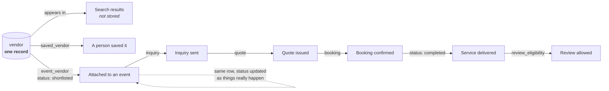
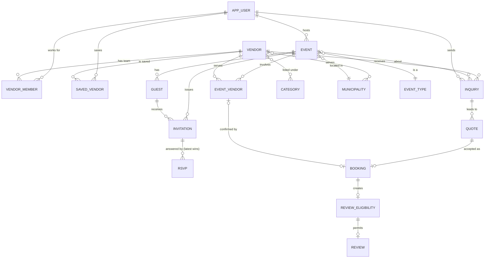
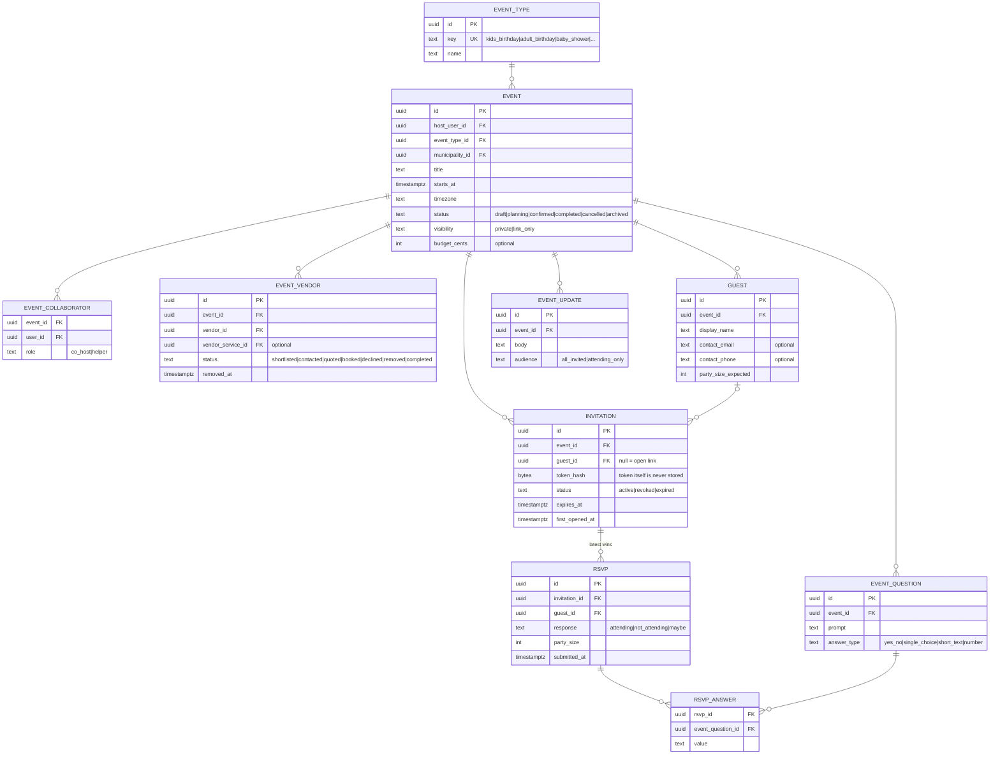
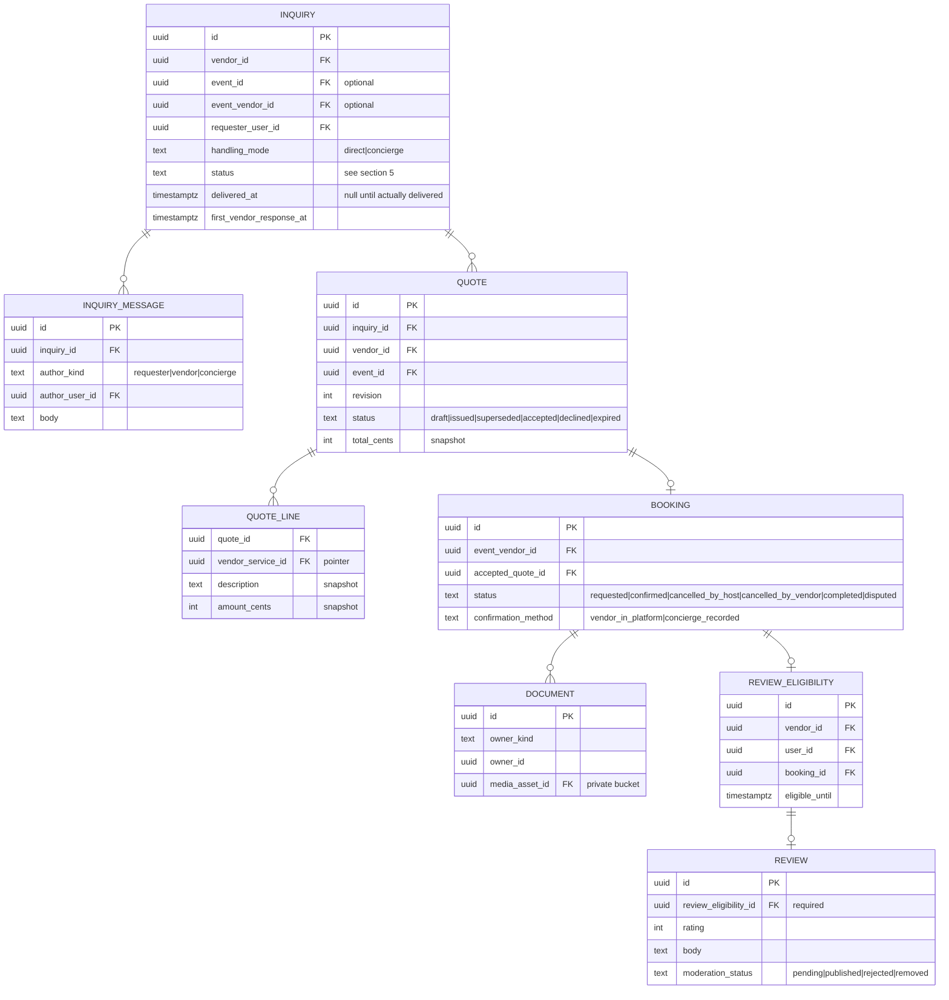

# B — Domain & Data Model

**Status:** Proposed (Stage 0). Awaiting product owner approval.
**Last updated:** 2026-10-09

This is the most important document in the set. If the data model is right, features
can be added for years. If it is wrong, every feature after the mistake inherits it.

---

## 1. Rules that apply to every table

These are decided now because changing them later means touching every table.

| Rule | What it means | Why |
|---|---|---|
| **Stable identity** | Every record has a permanent `id` (UUID v7). It never changes, never gets reused. | A vendor is the same vendor whichever screen you reach it from. UUIDs also can't be guessed by incrementing a number in the address bar. |
| **Public addresses are separate from identity** | Vendors also have a human-readable `slug` (e.g. `/vendors/lakeside-face-painting`). Slugs can change; old slugs redirect. | Links shared on Facebook keep working after a business renames itself. |
| **One source of truth** | A fact is stored in exactly one place. Other records point to it; they do not copy it. | No conflicting versions of a vendor's name or an event's date. |
| **Deliberate snapshots** | Where a record must preserve what was true *at the time* (a quote's price, a booking's terms), it stores a snapshot **and** a pointer to the live record, and says so in its definition. | A quote shouldn't change because the vendor later edits their price list. This is the only permitted kind of duplication. |
| **Nothing important is hard-deleted** | Relationships end with a status change and a timestamp (`removed_at`, `archived_at`), not a `DELETE`. | History survives when a vendor is removed from an event. |
| **Real deletion exists for personal data** | When a person asks to be deleted, or a retention period ends, personal fields are erased or anonymised. | Privacy law and basic decency. History is kept; identity is not. See [E §7](./E-security-and-privacy-model.md#7-retention-and-deletion). |
| **Every status change is recorded** | Status changes on key records write a row to `status_change` (who, when, from, to, why). | We can always answer "when did this booking get cancelled, and by whom?" |
| **Time** | Stored in UTC. Events also store their local IANA timezone (`America/Toronto`). | Correct times across daylight saving, and ready for communities in other zones. |
| **Money** | Integer cents plus a currency code (`CAD`). Never floating point. | Floating point loses cents. |
| **Place** | Every vendor and every event is tied to structured geography (`municipality`), never just free text. | Expansion to new towns is adding rows, not rewriting search. |
| **Reference data, not code** | Event types, categories, municipalities, attribute definitions live in tables an admin can edit. | Adding "baby shower" or "Barrie" does not need a developer. |
| **Ownership on every row** | Every private record can be traced to who owns it (a user, a vendor, or the platform) in one hop. | Authorization checks are simple and auditable. |

## 2. The spine: five canonical records

Almost everything in the product is a relationship between these five things.

| Canonical record | What it represents | Who owns it |
|---|---|---|
| **Person** (`app_user`) | Someone with an account: an organizer, a vendor team member, or platform staff. One person can be all three. | Themselves |
| **Vendor** (`vendor`) | A local business that provides event services. One per business. | The platform until claimed; then the vendor's team |
| **Event** (`event`) | Something being organized. | The host |
| **Place** (`municipality`) | A real town or township. | The platform |
| **Category** (`category`) | A type of service ("Entertainment → Face painting"). | The platform |

Guests are deliberately **not** people with accounts. A guest is a row on one event's
guest list, owned by that event's host. See §4.3.

## 3. How a vendor travels through the whole product

This is the answer to *"can you show me how the data connects?"* Follow one vendor.
At every step, the **same `vendor.id`** is used. Nothing is copied into a new vendor
record.



What each arrow means, and what it does **not** mean, is in §5.

## 4. Entity-relationship diagrams

Grouped by domain so each diagram stays readable. Stage badges: **[S1]** built in
Stage 1, **[S2]** Stage 2, and so on. **[D]** means designed now, built only when
approved.

### 4.1 The whole picture (core relationships only)



### 4.2 Discovery & vendor domain — [S1]

```mermaid
erDiagram
    VENDOR {
        uuid id PK
        text slug UK
        text display_name
        text listing_status "draft|pending_review|published|unpublished|archived"
        text claim_status "unclaimed|claim_pending|claimed"
        text verification_status "unverified|verified|lapsed"
        text source "admin_entered|vendor_submitted"
        uuid primary_municipality_id FK
    }
    VENDOR_SERVICE {
        uuid id PK
        uuid vendor_id FK
        text name
        text pricing_model "fixed|starting_at|hourly|custom_quote|not_listed"
        int  price_cents "null unless vendor provided it"
    }
    CATEGORY {
        uuid id PK
        uuid parent_id FK "null for top level"
        text slug UK
        text name
    }
    VENDOR_CATEGORY {
        uuid vendor_id FK
        uuid category_id FK
        bool is_primary
    }
    ATTRIBUTE_DEFINITION {
        uuid id PK
        text key UK "e.g. indoor_outdoor"
        text data_type "boolean|number|single_choice|multi_choice|text"
        bool is_filterable
    }
    ATTRIBUTE_OPTION {
        uuid id PK
        uuid attribute_definition_id FK
        text value
    }
    VENDOR_ATTRIBUTE_VALUE {
        uuid vendor_id FK
        uuid attribute_definition_id FK
        uuid option_id FK "for choice types"
        numeric value_number
        bool value_boolean
    }
    VENDOR_SERVICE_AREA {
        uuid vendor_id FK
        uuid municipality_id FK
    }
    MUNICIPALITY {
        uuid id PK
        text name
        text region "Simcoe County"
        geography centroid
    }
    VERIFICATION_RECORD {
        uuid id PK
        uuid vendor_id FK
        text check_type "business_registration|insurance|identity|..."
        text outcome
        uuid evidence_media_id FK "private"
        uuid checked_by FK
    }
    VENDOR_CLAIM {
        uuid id PK
        uuid vendor_id FK
        uuid claimant_user_id FK
        text status "submitted|approved|rejected|withdrawn"
    }

    VENDOR ||--o{ VENDOR_SERVICE : offers
    VENDOR ||--o{ VENDOR_CATEGORY : ""
    CATEGORY ||--o{ VENDOR_CATEGORY : ""
    CATEGORY ||--o{ CATEGORY : "parent of"
    ATTRIBUTE_DEFINITION ||--o{ ATTRIBUTE_OPTION : ""
    VENDOR ||--o{ VENDOR_ATTRIBUTE_VALUE : ""
    ATTRIBUTE_DEFINITION ||--o{ VENDOR_ATTRIBUTE_VALUE : ""
    VENDOR ||--o{ VENDOR_SERVICE_AREA : ""
    MUNICIPALITY ||--o{ VENDOR_SERVICE_AREA : ""
    VENDOR ||--o{ VERIFICATION_RECORD : ""
    VENDOR ||--o{ VENDOR_CLAIM : ""
```



### 4.3 Event, guest & invitation domain — [S2]



### 4.4 Engagement & commerce domain — [S3] inquiries, [S4/D] the rest



Note the last two lines: **a review cannot exist without an eligibility record, and an
eligibility record cannot exist without a booking.** This makes "only reviews tied to a
real interaction" a property of the database, not a policy someone has to remember.

## 5. Lifecycle states and what they do NOT mean

The brief is explicit that these are not interchangeable. The table below is the
contract. User-facing copy must match the "means" column and must never imply the
"does not mean" column.

| Moment | Where it lives | It means | It does **not** mean |
|---|---|---|---|
| Vendor appears in search | Computed at query time; not stored (impressions logged to `analytics_event` from Stage 4) | The listing is `published` and matches the filters | Endorsement, availability, or that the vendor knows Tallo exists |
| Person saves a vendor | `saved_vendor` | A private bookmark | Any contact with the vendor |
| Vendor attached to event | `event_vendor.status = shortlisted` | The host is considering this vendor | Contacted, available, agreed, or booked |
| Inquiry created | `inquiry.status = submitted` | Tallo has received the host's message | The vendor has seen it |
| Inquiry delivered | `inquiry.status = delivered`, `delivered_at` set | It reached the vendor by a recorded route (in-platform for claimed vendors; a concierge-logged call or email for unclaimed) | The vendor has read or replied |
| Vendor responded | `inquiry.status = vendor_responded` | A reply was received and recorded | Availability or agreement to a price |
| Quote issued | `quote.status = issued` | The vendor stated a price for specific services | A booking |
| Booking confirmed | `booking.status = confirmed` | Both sides have agreed, recorded by the vendor in-platform or by concierge with a note | Payment has happened (we don't process payments) |
| Service completed | `booking.status = completed` | The event date passed and neither side reported a problem within the window | That it went well |
| Review eligible | `review_eligibility` row | This person may review this vendor, until a deadline | That a review exists |

### State machines

Only these transitions are allowed. Anything else is rejected by the server.

**`vendor.listing_status`**
```
draft → pending_review → published ⇄ unpublished
                ↓            ↓            ↓
              draft       archived     archived
```

**`event_vendor.status`** — the host controls `shortlisted` and `removed`; the others
are set by the system as things actually happen elsewhere.
```
shortlisted → contacted   (when an inquiry for it is delivered)
contacted   → quoted      (when a quote is issued)
quoted      → booked      (when a booking is confirmed)
booked      → completed   (when the booking completes)
any         → declined    (vendor declines)
any         → removed     (host removes; row kept, removed_at set)
```

**`inquiry.status`**
```
submitted → delivered → vendor_responded → closed
     ↓          ↓              ↓
 withdrawn  no_response     closed
```

**`invitation.status`** — opening a link is recorded (`first_opened_at`) but is not a
status change, so "opened" can never be mistaken for "accepted".
```
active → revoked   (host revokes)
active → expired   (expires_at passes)
```

## 6. Metadata strategy

The brief asks us to avoid two failure modes: stuffing everything into a generic blob,
and building a universal metadata engine nobody needs. Our approach has three tiers.

**Tier 1 — Real columns.** Anything that drives core behaviour, permissions, or
lifecycle: name, status, owner, dates, municipality, price. Changes to these need a
migration, which is correct because changes to these *should* be deliberate.

**Tier 2 — Controlled attributes.** Things that describe a vendor, that we want to
filter on, and that will keep growing: *indoor/outdoor*, *suitable for ages*, *travels
to venue*, *wheelchair accessible venue*, *max group size*. These use
`attribute_definition` (the list of allowed attributes and their type) +
`attribute_option` (allowed values for choice types) + `vendor_attribute_value` (the
actual values).

- An admin adds a new filter by adding a definition. No developer, no migration.
- Values are typed and validated against the definition, so "Yes", "yes", and "Y" can't
  coexist.
- Definitions can be scoped to categories, so "max group size" appears for party venues
  and not for cake bakers.
- This is deliberately small: five data types, no formulas, no nested attributes.

**Tier 3 — Display-only extras.** A small `profile_extras` JSON field on `vendor` for
things that are only ever displayed, never searched or filtered (e.g. "years in
business" phrased the vendor's way). If something in Tier 3 starts being filtered on, it
is promoted to Tier 2. A database check stops Tier 3 from being used for anything that
has a Tier 2 definition.

### How we add things without rewriting

| To add… | You do… | Developer needed? |
|---|---|---|
| A new category or subcategory | Admin → Categories → Add | No |
| A new event type (e.g. "Retirement party") | Admin → Event types → Add | No |
| A new filter (e.g. "Offers gluten-free") | Admin → Attributes → Add, choose type and categories | No |
| A new town | Admin → Places → Add | No |
| A new kind of RSVP question | Host does it per event | No |
| A new **core** field (one that changes behaviour) | Migration + code | Yes, by design |

## 7. Relationship semantics

| Relationship | Cardinality | What ending it means |
|---|---|---|
| Person ↔ Vendor (`vendor_member`) | many-to-many, with role | Membership is ended (`ended_at`), not deleted. Past actions stay attributed. |
| Person → Event (host) | one host, many events | Host transfer is a recorded change, not an edit. |
| Event ↔ Vendor (`event_vendor`) | many-to-many | Removing sets `status=removed`, `removed_at`. Any inquiries, quotes, bookings stay linked. |
| Event → Guest | one-to-many | Removing a guest revokes their invitations; their past RSVP is kept for the host's records until the event's retention period ends. |
| Invitation → RSVP | one-to-many, latest wins | Guests can change their answer. History kept. |
| Inquiry → Event | optional | People can ask a vendor a question without having created an event. |
| Booking → Review | at most one review per booking | Enforced by the database. |

## 8. Future migrations we already know about

No design survives contact with real users unchanged. These are the changes we can
foresee and how they'll be made without a rewrite.

| Likely future need | Migration path |
|---|---|
| A business with multiple listings, or non-vendor organisations | Add `organization` table above `vendor`; add nullable `vendor.organization_id`; backfill one organisation per vendor. Existing vendor IDs unchanged. |
| Households (shared accounts for co-parents) | Add `household` and `household_member`; events gain optional `household_id`. `host_user_id` stays. Already partly covered by `event_collaborator`. |
| Distance-radius search ("within 30 km") | `municipality.centroid` already stores coordinates; add `vendor.base_location` and a radius. PostGIS is already available. |
| Search volume beyond what Postgres handles well | Add a search index (e.g. Typesense) fed from Postgres. Postgres stays the source of truth. Unlikely before tens of thousands of listings. |
| Vendor subscriptions | `entitlement` table keyed on `vendor_id` (designed, not built). Features check entitlements, not plan names. |
| Sponsored placements | `placement` table with explicit `is_sponsored` and date range; UI must label them. Ranking code reads it; it never edits vendor data. |

## 9. Full table catalogue

The proposed SQL for Stage 1 is in [schema/stage1-proposed.sql](./schema/stage1-proposed.sql).

| Table | Domain | Stage | Purpose |
|---|---|---|---|
| `app_user` | Identity | S1 | Profile for an authenticated person. Linked 1:1 to the auth provider's user ID. |
| `platform_role` | Identity | S1 | Grants `admin` or `concierge` to staff. Checked server-side. |
| `municipality` | Place | S1 | Real towns and townships. |
| `category` | Taxonomy | S1 | Hierarchical service categories. |
| `attribute_definition` | Taxonomy | S1 | Allowed filterable attributes. |
| `attribute_option` | Taxonomy | S1 | Allowed values for choice attributes. |
| `attribute_definition_category` | Taxonomy | S1 | Which attributes apply to which categories. |
| `vendor` | Vendor | S1 | The canonical business record. |
| `vendor_member` | Vendor | S1 | Who can manage a vendor, with role. |
| `vendor_category` | Vendor | S1 | Vendor ↔ category. |
| `vendor_service` | Vendor | S1 | Services and packages, with honest pricing models. |
| `vendor_service_area` | Vendor | S1 | Municipalities served. |
| `vendor_attribute_value` | Vendor | S1 | Typed attribute values. |
| `vendor_slug_history` | Vendor | S1 | Old slugs, for redirects. |
| `vendor_claim` | Vendor | S1 | Requests to take ownership of an unclaimed listing. |
| `verification_record` | Vendor | S1 | Evidence-backed verification checks. |
| `media_asset` | Media | S1 | Every stored file: owner, visibility, storage path. |
| `vendor_media` | Media | S1 | Which images belong to a vendor, in what order. |
| `collection` / `collection_item` | Discovery | S1 | Editorially curated lists. |
| `saved_vendor` | Discovery | S1/S2 | Favourites. Stage depends on decision D-02. |
| `status_change` | Audit | S1 | Every status transition on key records. |
| `audit_log` | Audit | S1 | Every admin and permission-sensitive action. |
| `event_type` | Event | S2 | Reference list of event types. |
| `event` | Event | S2 | The event. |
| `event_collaborator` | Event | S2 | Co-hosts and helpers. |
| `event_vendor` | Event | S2 | The event ↔ vendor relationship. |
| `guest` | Guest | S2 | A guest on one event's list. |
| `invitation` | Guest | S2 | A secure, revocable link. |
| `event_question` | Guest | S2 | Host-defined RSVP questions. |
| `rsvp` / `rsvp_answer` | Guest | S2 | Responses. |
| `event_update` | Event | S2 | Messages from host to guests. |
| `inquiry` / `inquiry_message` | Engagement | S3 | Inquiries and their thread. |
| `quote` / `quote_line` | Commerce | S4 | Quotes with snapshots. |
| `booking` | Commerce | S4 | Agreed service. |
| `document` | Commerce | S4 | Agreements and attachments (private). |
| `review_eligibility` / `review` | Reputation | S4 | Interaction-gated reviews. |
| `notification` / `notification_preference` | Comms | S4 | Only when a notification channel is approved. |
| `analytics_event` | Analytics | S4 | Append-only first-party events. No third-party tracker. |
| `entitlement` / `placement` | Commercial | D | Designed only. |
