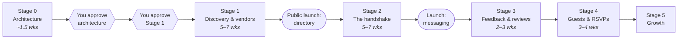

# Roadmap & Estimates

**Status:** Proposed (Stage 0, revision 2).
**Last updated:** 2026-10-09

**Revision 2:** stages reorganised around the consumer–vendor handshake. Messaging
moves from a late, optional stage to the centre of Stage 2. Quotes, vendor-confirmed
bookings and payments are gone. Reviews come straight after the handshake (D-14).

## How to read the estimates

- **Working weeks of one experienced developer**, as a range.
- They assume your decisions and reviews come back within about two working days.
  **Review turnaround is usually the biggest factor in calendar time.**
- They include automated tests, permission tests, documentation, and fixing what review
  finds. Not legal review or content entry.
- If a stage trends past its range, you'll hear at the midpoint, not the end.

## Overview

Every arrow after Stage 1 has an approval gate. Approving one stage never approves the
next.

**Why this order.** Messaging only works with businesses that have claimed their
listing. Stage 1 puts the directory in front of the public *and* gives local businesses
5–7 weeks to claim their profiles, so the first consumer who taps "Message" on Stage 2
launch day has someone on the other end. Reviews follow because they complete the
loop: by the time Stage 3 ships, the first events planned through Localites will have
happened.

---

## Stage 0 — Discovery & architecture

| # | Deliverable | Where | Status |
|---|---|---|---|
| 1 | Capability map | [A §4](./A-product-blueprint.md#4-capability-map) | ✅ Revised |
| 2 | **Roles & the consumer–vendor relationship** | [roles-and-relationships.md](./roles-and-relationships.md) | ✅ New |
| 3 | Screen inventory | [screen-inventory.md](./screen-inventory.md) | ✅ Revised |
| 4 | Domain model & diagrams | [B](./B-domain-and-data-model.md) | ✅ Revised |
| 5 | Proposed database: Stage 1 and Stages 2–3 | [schema/](./schema/) | ✅ 82/82 checks pass |
| 6 | Permissions & privacy | [E](./E-security-and-privacy-model.md) | ✅ Revised |
| 7 | Architecture & deployment | [C](./C-architecture-decision-log.md), [F](./F-operational-runbook.md) | ✅ Revised |
| 8 | API & integrations | [api-strategy.md](./api-strategy.md) | ✅ Revised |
| 9 | Backup & recovery | [F](./F-operational-runbook.md) | ✅ |
| 10 | Testing strategy | [testing-strategy.md](./testing-strategy.md) | ✅ Revised |
| 11 | Roadmap | This document | ✅ Revised |
| 12 | Decisions & actions | [H](./H-product-owner-action-register.md) | ✅ Revised |
| — | Clickable prototypes (5 screens, PO-09) | — | ⏳ After D-00 |

**Remaining:** ~0.5–1 week for prototypes of home, search, vendor profile, a
conversation (both sides), and an event plan with "Mark as booked".

---

## Stage 1 — Discovery & vendor foundation

**Outcome.** A real, public directory of local event vendors, useful to a parent on its
own, with the admin tools to build it. **Local businesses claim their listings** so
they're ready for messaging.

**In scope.** Landing page · category browsing · search with filters (town, category,
attributes, keyword, typo-tolerant) · vendor profiles (mobile-first, fast, findable on
Google) · honest empty states · vendor website/phone with anonymous click counts (D-04)
· vendor accounts: sign up, claim, edit, submit for review, manage team · admin:
create, review, publish, claims, verification, categories, attributes, places,
collections · image upload · audit trail · privacy policy and terms (from PO-07) ·
production environment, monitoring, backups, restore drill.

**Excluded.** Consumer accounts, events, messaging, reviews (later stages). Anything
involving payment (never).

**Dependencies.** D-00, D-01, D-03, D-04, D-07, D-09, D-11; PO-03, PO-05, PO-07 (before
public launch), PO-08.

**Effort.** 5–7 weeks.
| Work | Weeks |
|---|---|
| **Fit test (first day):** one vendor page, one search, one signed-in page on Cloudflare's free plan; confirm it fits the free limits (ADR-005) | 0.2 |
| Foundations: setup, CI, environments, sign-in, permissions module, audit, migrations, nightly backup | 1.5 |
| Taxonomy, vendor model, admin listing tools | 1.5–2 |
| Public discovery: landing, browse, search, profile, SEO | 1.5–2 |
| Vendor accounts, claiming, self-editing, team | 1 |
| Hardening: accessibility, security tests, restore drill, launch checklist | 0.5–1 |

**Acceptance criteria.**
1. A visitor with no account can browse, search, filter, and view a profile on a phone.
2. Search finds the right vendor despite common misspellings.
3. An admin can create and publish a listing and see it in search within a minute.
4. A business can claim its listing; after approval, its team can edit it.
5. The database rejects dishonest states (Stage 1 schema checks pass).
6. Every rule in [E §4.1](./E-security-and-privacy-model.md#41-discovery--listings-stage-1)
   has passing tests, including cross-vendor and role-escalation attempts.
7. Every page passes automated accessibility checks and works at 360px wide.
8. A backup has been restored successfully and recorded in G.
9. Every service is on a free plan; the only payment is the domain.
10. **Success measure to watch:** how many listed businesses claim their profile.

**Risks.** Too few vendors (high; mitigated by D-03 B and D-09 B) · a business objects to
being listed (medium; clear labels, fast removal, personal contact) · legal review
delays launch (medium; start PO-07 now) · **low claim rate leaves Stage 2 with few
messageable vendors** (medium; PO-08 claim calls; consumer interest signals in Stage 2
give a truthful reason to claim).

---

## Stage 2 — The handshake

**Outcome.** A consumer can find a vendor, talk to them directly, share files, plan
the event, and keep track of who they've booked. A vendor can reply, share files, and
see who marked them booked.

**In scope.**
- Consumer accounts; switching between "My events" and "My business" (D-13 R8)
- Saved vendors
- Events: type, date, town; optional time, venue note, guest estimate, age range,
  private budget and notes
- Event plan: **Add to event** (considering) → **Mark as booked** → un-mark / remove
- Vendor view of bookings marked, with event summary; **flag** if not real
- **Conversations**: consumer starts; vendor team replies; optionally about an event;
  text + files (images, PDFs); updates every ~15 seconds on screen; batched email
  notices; private unread counts
- Block and report, both sides; reports queue for the platform team
- "Let them know you're interested" for unclaimed businesses, plus a notice when they
  join (D-05)
- Per-person database rules on events, conversations, messages and files (ADR-004)
- "Localites doesn't process payments" notice in every conversation (ADR-018)

**Excluded.** Typing indicators, read receipts, online status, group chats, voice/video;
text-message notifications; reviews (Stage 3); guests (Stage 4); payment of any kind.

**Dependencies.** Stage 1 released and businesses claiming; D-05, D-10, D-13 decided;
domain registered so email works (D-07).

**Effort.** 5–7 weeks.
| Work | Weeks |
|---|---|
| Consumer accounts, side switching, saved vendors | 0.5–1 |
| Events and event plan (considering / booked / flag) | 1–1.5 |
| Conversations, messages, files, unread counts, polling | 1.5–2 |
| Email notices (batched), block, report, reports queue, interest signals | 1 |
| Per-person database rules, security tests, hardening | 1–1.5 |

**Acceptance criteria.**
1. A consumer can go from a vendor profile to a sent message in under a minute on a
   phone.
2. A vendor team member receives an email notice and can reply from their phone.
3. Both sides can share a photo and a PDF; nobody else can open them, even with the link
   (tested).
4. Only the consumer can mark booked; the vendor is notified and can flag it.
5. A vendor can never see a consumer's "considering" list, budget, notes, or guest list
   (tested).
6. Vendors cannot start conversations; nobody can post into a conversation they're not
   in (database-enforced, already proven).
7. The words in [A §6](./A-product-blueprint.md#6-language-rules) are checked across all
   screens and emails: no wording implies payment or confirmation.
8. Blocking stops messages both ways; reports reach the queue.

---

## Stage 3 — Feedback & reviews

**Outcome.** After an event, consumers are asked how each booked vendor did. Reviews
build vendors' reputations; vendors can reply.

**In scope.** Feedback requests the morning after (email + in-app) and one reminder ·
retroactive requests for events in the previous 60 days · review form (stars +
comments) · eligibility per D-06 · moderation queue with written policy · booking-flag
resolution · publication on profiles · vendor reply (once) · rating summary (from 3
reviews).

**Dependencies.** Stage 2; D-06; review policy reviewed by the lawyer.

**Effort.** 2–3 weeks.

**Acceptance criteria.** The database refuses every ineligible review (already proven).
A consumer can leave a review from the email in under two minutes. Nothing is published
without a recorded moderator. Ratings appear only from three reviews.

---

## Stage 4 — Guests & RSVPs

**Outcome.** Consumers invite guests with secure links and collect RSVPs without guests
creating accounts.

**In scope.** Guest list · per-guest and open invitation links · revoke/expire ·
account-free RSVP with plus-ones and host questions · attendance view · event updates.

**Dependencies.** Stage 2; D-08, D-10. **Effort:** 3–4 weeks.

---

## Stage 5 — Growth

Each item proposed and approved separately, based on real use: vendor insights (visits,
clicks, conversations, bookings marked, reviews) · more communities (data only) ·
clearly labelled sponsored placements or vendor subscriptions, if the business model
calls for them (never affecting reviews) · text-message notices (needs a service and
approval).

---

## Cross-stage risks

| Risk | Mitigation |
|---|---|
| Vendors don't claim, so messaging has nobody to talk to | Claim drive during Stage 1 (PO-08); consumer-interest signals; measure claim rate weekly |
| Vendors don't reply, so consumers lose trust | Email notices; reply-rate visible to the platform team; later, a gentle "replies usually within a day" on profiles (only once true) |
| Messaging misuse: spam, harassment, fake invoices | Vendors can't start conversations; block/report; "Localites doesn't process payments" notice; reports reviewed daily |
| Fake bookings used to post unfair reviews | Consumer-only "booked"; vendor flag; D-06 conversation requirement; moderation |
| Nobody available when messaging breaks | Alerts by email to you; a ready-made note for starting a fix session (D-11) |
| A free-plan limit is reached (most likely email at 100/day, then file storage) | Free plans stop rather than bill. We warn you at 80% with free options first: tighter email batching, a second free email service, photo compression ([cost-model.md](./cost-model.md)) |
| Cloudflare's free plan doesn't fit, or its terms don't allow business use | Fit test and terms check before real building starts; options brought to you before anything costs money |
| Building beyond validated need | Stage gates; Stage 5 items need usage evidence |
| Estimates slip | Mid-stage check-in with a revised range and reason |
