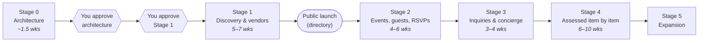

# Roadmap & Estimates

**Status:** Proposed (Stage 0).
**Last updated:** 2026-10-09

## How to read the estimates

- Estimates are in **working weeks of one experienced developer**, given as a range.
- They assume your decisions and reviews come back within about two working days.
  **Review turnaround is usually the biggest factor in calendar time**, more than
  build time.
- They include automated tests, permission tests, documentation updates, and fixing
  what review finds. They don't include legal review or content entry.
- Ranges are honest, not padded. If a stage is trending past its range, you'll hear
  about it at the midpoint, not the end.

## Overview

Every arrow after Stage 1 has an approval gate. Approving one stage never approves the
next.

---

## Stage 0 — Discovery & architecture

**Outcome.** You understand and approve what we're building and how, before
significant money or time is spent.

**Deliverables** (status as of today):
| # | Deliverable | Where | Status |
|---|---|---|---|
| 1 | Product capability map | [A §4](./A-product-blueprint.md#4-capability-map) | ✅ Draft |
| 2 | Screen inventory | [screen-inventory.md](./screen-inventory.md) | ✅ Draft |
| 3 | Domain model & relationship diagrams | [B](./B-domain-and-data-model.md) | ✅ Draft |
| 4 | Proposed database schema | [schema/stage1-proposed.sql](./schema/stage1-proposed.sql) | ✅ Draft, tested |
| 5 | Permissions & privacy matrix | [E](./E-security-and-privacy-model.md) | ✅ Draft |
| 6 | Application architecture & deployment | [C](./C-architecture-decision-log.md), [F](./F-operational-runbook.md) | ✅ Draft |
| 7 | API & integration strategy | [api-strategy.md](./api-strategy.md) | ✅ Draft |
| 8 | Migration, backup & recovery plan | [F §4–7](./F-operational-runbook.md) | ✅ Draft |
| 9 | Testing strategy | [testing-strategy.md](./testing-strategy.md) | ✅ Draft |
| 10 | Phased roadmap | This document | ✅ Draft |
| 11 | Assumptions, decisions, approvals | [H](./H-product-owner-action-register.md) | ✅ Draft |
| — | Representative screen prototypes | — | ⏳ Next, after D-00 |

**Remaining effort:** ~0.5 week for clickable prototypes of four representative screens
(landing, search results, vendor profile, admin listing editor), so you can judge the
experience on your phone before Stage 1 is approved.

---

## Stage 1 — Discovery & vendor foundation

**Outcome.** A real, public, useful directory of local event vendors in the launch
area, with the admin tools to build and maintain it. Useful to a parent on its own,
even before any event features exist.

**In scope.**
- Landing page
- Category browsing (two levels)
- Search with filters: town, category, typed attributes, keyword
- Vendor profile pages, mobile-first, fast, findable by Google
- Honest empty states ("We don't have a magician listed in Severn yet — here are ones
  that travel there")
- Vendor contact links + click counting (if D-04 = A)
- Vendor accounts: sign up, claim a listing, edit own listing, submit for review, manage
  team
- Admin: create/edit listings, review and publish, approve claims, record
  verification, manage categories/attributes/places, curated collections
- Image upload with server-side checks
- Audit trail for every admin action
- Privacy policy and terms pages (content from legal review, PO-07)
- Production environment, monitoring, backups, restore drill

**Excluded.** Organizer accounts and favourites (if D-02 = B), events, invitations,
inquiries, reviews, payments, maps, notifications beyond sign-in emails.

**Dependencies.** D-00, D-01, D-02, D-03, D-04, D-07, D-09 decided; PO-03 accounts
created; PO-05 categories confirmed; PO-07 legal review before public launch.

**Effort.** 5–7 weeks.
| Work | Weeks |
|---|---|
| Foundations: project setup, CI, environments, auth, policy module, audit, migrations | 1.5 |
| Taxonomy, vendor model, admin listing tools | 1.5–2 |
| Public discovery: landing, browse, search, profile, SEO | 1.5–2 |
| Vendor accounts, claim flow, vendor self-editing | 1 |
| Hardening: accessibility pass, security test matrix, restore drill, launch checklist | 0.5–1 |

**Acceptance criteria.**
1. A visitor with no account can browse, search, filter, and view a profile on a phone.
2. Search returns relevant results for misspellings of common terms.
3. An admin can create a listing from nothing, publish it, and see it in search within
   one minute.
4. A vendor can sign up, claim their listing, and after admin approval edit it; their
   edits go through review if the listing was published.
5. No status can be set without its supporting fact (verified needs a check;
   published needs a publish date). Proven by database tests.
6. Every row in [E §4.1](./E-security-and-privacy-model.md#41-discovery--vendor-stage-1)
   has passing tests, including cross-vendor and role-escalation attempts.
7. Every page passes automated accessibility checks and works at 360px wide.
8. A backup has been restored successfully and recorded in G.
9. Public pages score well on mobile page-speed checks (target: largest content painted
   under 2.5 s on a mid-range phone).

**Release plan.** Soft launch to you and a few trusted locals for one week → fix →
public launch. Unclaimed businesses are contacted before public launch (per D-03).

**Risks.**
| Risk | Likelihood | Mitigation |
|---|---|---|
| Too few vendors for a useful directory | High | D-03 option B; D-09 option B; curated collections; honest empty states |
| A business objects to being listed | Medium | Clear "unclaimed" label; fast removal; contact before launch; legal review |
| Legal review delays launch | Medium | Start PO-07 now |

---

## Stage 2 — Complete event journey

**Outcome.** An organizer can create an event, shortlist vendors from the directory,
invite guests with secure links, and see who's coming. Guests RSVP without an account.

**In scope.** Organizer accounts; favourites (if deferred); event create/edit with type,
date, place, optional budget and age range; co-hosts and helpers; add/remove vendors
(shortlist only — honest status); guest list; per-guest and open invitation links;
revoke/expire; account-free RSVP with plus-ones and host-defined questions; host RSVP
view; event updates visible on the invitation page; per-request database rules on guest
data (ADR-004).

**Excluded.** Sending invitations by email/SMS from Tallo (D-08); contacting vendors
(Stage 3); payments; event photos.

**Dependencies.** Stage 1 released; D-08, D-10 decided.

**Effort.** 4–6 weeks.

**Acceptance criteria (highlights).**
1. Shortlisting a vendor uses the existing vendor record; no second vendor record can
   be created by any path.
2. A guest link shows only that invitation and RSVP form; tested against direct-ID
   access to other events and guest lists.
3. Revoked and expired links stop working immediately.
4. "Opened" and "RSVP'd" are reported separately to the host.
5. Removing a vendor from an event keeps the history.
6. Guest RSVP works on a phone in under 30 seconds.

---

## Stage 3 — Vendor engagement

**Outcome.** Organizers can send an inquiry to any vendor, about an event or not.
Claimed vendors respond in Tallo; inquiries to unclaimed vendors go to a concierge queue.

**In scope.** Inquiry form; routing by claim status; concierge queue with delivery and
response logging; vendor inbox; simple message thread; statuses per
[B §5](./B-domain-and-data-model.md#5-lifecycle-states-and-what-they-do-not-mean);
`event_vendor` moves to `contacted` only on recorded delivery; email notifications of
new inquiries to vendors (within the approved email plan).

**Excluded.** Real-time chat, read receipts, typing indicators, attachments.

**Dependencies.** Stage 2; D-05 decided; email plan sufficient (ADR-013).

**Effort.** 3–4 weeks.

---

## Stage 4 — Commercial & operational

Assessed item by item, each with its own proposal and approval, based on what Stages
1–3 show. Candidates: quotes and bookings (~2–3 wks), documents (~1 wk), reviews
(~1.5–2 wks, after D-06), vendor engagement reports (~1 wk), manual entitlements (~1
wk), sponsored placements (~1 wk), notifications/reminders (~1–2 wks, needs a service
approval).

## Stage 5 — Expansion

New communities (data-only: add municipalities and categories), richer discovery, and
whatever the usage data points to.

---

## Cross-stage risks

| Risk | Mitigation |
|---|---|
| Building Stage 4 features before validating demand | Stage gates; Stage 4 proposals must cite usage evidence |
| Vendors don't engage, so claim rate is low | Measure claim rate from week 1 of launch; it's the Stage 1 success metric to watch |
| Nobody available when production breaks | D-11 |
| Concierge workload grows faster than expected | Track minutes/day; Stage 3 tools designed for speed; escalate early |
| Provider price increase | Standard PostgreSQL limits lock-in; alternatives documented in C |
| Estimates slip | Mid-stage check-in with a revised range and the reason |
