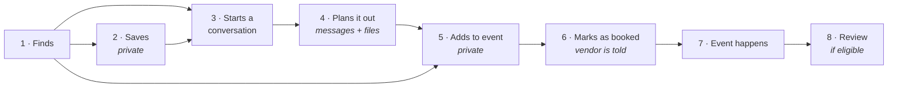

# Roles & Relationships: Consumers and Vendors

**Status:** Approved in direction (D-00, 10 October 2026). The eight consumer–vendor rules (R1–R8)
still await D-13.
**Last updated:** 2026-10-09

Localites has **two users**: the **consumer**, who is planning an event, and the
**vendor**, a local business that provides a service for it. Everything in the product
exists to help those two find each other, talk, and plan, and then to let the consumer
manage what they've arranged.

Localites is the **digital handshake** between them. It is **never** a party to the deal
and **never handles money**.

---

## 1. The two users

### The consumer

Someone planning an event: a parent organising a birthday, someone hosting a shower, a
community group running a fundraiser.

| Without an account | With a (free) account |
|---|---|
| Browse, search and filter vendors | Save vendors |
| Read vendor profiles and reviews | Create events |
| See a vendor's own website and phone number | Message vendors and share files |
| | Add vendors to an event |
| | Mark a vendor as **booked** |
| | Get asked how it went, and leave a review |
| | Invite guests and collect RSVPs (later stage) |

### The vendor

A local business: a face painter, a bakery, a party venue, a DJ. In the system, a
vendor is the **business** (one record, forever). The people who run it are its
**team**:

| Team role | Can do |
|---|---|
| **Owner** | Everything below, plus manage the team and ownership |
| **Manager** | Edit the listing, read and reply to messages, reply to reviews |
| **Staff** | Read and reply to messages |

| A vendor can | A vendor cannot |
|---|---|
| Claim and manage their listing | Message a consumer who hasn't messaged them first |
| Reply to consumers and share files | See a consumer's private planning (who else they're considering) |
| See when a consumer marks them **booked** | See a consumer's guest list |
| Flag a booking that isn't real | Edit or remove a consumer's review |
| Reply publicly, once, to each review | Pay for better reviews or ratings |

### People who aren't users

| Who | Their relationship to Localites |
|---|---|
| **Guests** | People a consumer invites to their event. They RSVP through a private link and never need an account. Not users. |
| **Platform team** (you, initially) | Creates and approves listings, approves claims, moderates reviews, handles reports. Not a side of the marketplace. |

### One person, two hats

A face painter might also plan their own child's birthday. Rather than make them keep
two logins, **one account can be a consumer and a member of a vendor's team**. They
switch between "My events" and "My business" the way you'd switch accounts in a social
media app. Each side sees only what that side should see. (Decision D-13.)

---

## 2. The relationship between a consumer and a vendor

This is the heart of the product. A consumer and a vendor move through these steps.
Each step is recorded separately, and **each one is owned by someone specific**. Localites
never claims a step happened when it didn't.

| # | Step | Who does it | What the consumer sees | What the vendor sees | It does **not** mean |
|---|---|---|---|---|---|
| 1 | **Finds** the vendor | Consumer | The public profile | Totals: times seen in search, profile visits, website/phone taps (no names; D-22) | Localites endorses them, or that they're available |
| 2 | **Saves** the vendor | Consumer | It's in their saved list | Only a total of how many people saved them, never who (D-22) | Any contact |
| 3 | **Starts a conversation** | Consumer only | The conversation | The message, the consumer's name, and any event details the consumer chose to share | Availability or agreement |
| 4 | **Plans it out** | Both | Messages and files | Messages and files | That Localites is involved in any payment. An invoice shared here is between them. |
| 5 | **Adds to event** | Consumer | The vendor on their event plan | Nothing. Who a consumer is considering stays private. | Booked |
| 6 | **Marks as booked** | Consumer | "Booked" on their event | A notice: *"[Name] marked you as booked for Sat 14 Nov"* | That Localites confirmed it, or that any money moved |
| 7 | **Event happens** | — | The morning after: *"How was [Vendor]?"* | Nothing yet | — |
| 8 | **Leaves a review** | Consumer | Their review, once published | The review on their profile, and a chance to reply once | That Localites endorses the vendor |

Steps don't have to happen in this order. A consumer might add a vendor to an event
before messaging them, or mark as booked a vendor they phoned directly. The data model
allows any order. What it never allows is a later step being *reported* without it
actually having been recorded.

---

## 3. Rules we propose for the relationship

These shape trust on both sides. Each is a recommendation awaiting your approval as
decision **D-13**. You can accept them as a set or object to any one.

| # | Rule | Why |
|---|---|---|
| R1 | **Only consumers start conversations.** Vendors reply. | Stops vendors cold-messaging people, which would make consumers wary of signing up. |
| R2 | **A conversation is between one consumer and one vendor.** It can optionally be "about" one of the consumer's events. | Keeps every conversation private and easy to reason about. |
| R3 | **"Considering" is private; "booked" is shared.** Adding a vendor to an event tells no one. Marking them booked notifies the vendor. | Consumers can shortlist freely. Vendors learn about real bookings, which is also the most honest evidence we can give them that Localites works. |
| R4 | **Vendors can flag a booking that isn't real.** A flagged booking can't produce a review until the platform team resolves it. | Protects vendors from fake bookings used to post a bad review. |
| R5 | **The consumer controls what event details a vendor sees.** When a conversation is about an event, the vendor sees its type, date, town and approximate guest count, and nothing else. Never the guest list. | Private by default. |
| R6 | **Localites staff don't read conversations** unless one side reports it. Every such access is logged. | People need to trust the messaging to use it. |
| R7 | **Either side can block the other.** Blocking ends the conversation for both. | Basic safety. |
| R8 | **Messaging is only possible with claimed vendors.** For an unclaimed or unverified listing, the consumer sees the business's own phone and website, and can tap **Inquire**, which reaches the Localites team (D-04). | We can't deliver a message to a business that isn't on Localites, and we won't pretend to. Consumer interest becomes a truthful reason for the business to join. (Decisions D-04, D-05.) |

## 4. What Localites never does

- **Handles money.** No payments, deposits, checkout, card details, payouts, or fees
  between consumers and vendors. Not now, and not "later" without a new decision.
- **Implies it handles money.** The product never uses words like *pay*, *checkout*,
  *deposit*, *secure booking*, *book now*, or *booking confirmed*. The button is
  **"Mark as booked"**, and it's the consumer's own record.
- **Reads or interprets files.** A PDF shared in a conversation is just a file. If it's
  an invoice, that's between the consumer and the vendor.
- **Confirms on a vendor's behalf.** We never tell a consumer a vendor is available,
  has agreed, or is confirmed.

The terms of use will say plainly that Localites is not a party to any arrangement between a
consumer and a vendor. The lawyer's review (PO-07) should confirm the wording.

## 5. Reviews: how feedback becomes ratings

Proposed for decision **D-06**.

1. A consumer marks a vendor **booked** on an event.
2. The morning after the event date, Localites asks the consumer *"How was [Vendor]?"*, by
   email and in the app. If they don't respond, we remind them once a week later. After
   60 days, we stop asking.
3. **A consumer can review a vendor only if all of these are true:**
   - they marked that vendor booked on one of their events;
   - the event date has passed;
   - they and the vendor have **exchanged messages on Localites** (the vendor replied at
     least once);
   - the vendor hasn't flagged the booking as not real.
4. One review per booked vendor per event. A star rating (1–5) and optional written
   comments.
5. The platform team checks each review against a short written policy before it's
   published. Reviews are never edited by Localites, only published or declined.
6. The vendor can post **one** public reply.
7. A vendor's **average rating appears only once they have three published reviews**,
   so one unhappy (or overly kind) review doesn't define a business.

**Why require a Localites conversation?** Because "booked" is the consumer's word alone.
Requiring that the two actually talked on Localites means every review comes from a
relationship the platform recorded on both sides, which matches the preference in your
original brief. It also means vendors who haven't joined Localites can't be reviewed.
That's fairer to them, and another honest reason to claim their listing.

**The trade-off:** fewer reviews early on, because consumers who phoned a vendor
directly can't review them. Option B in D-06 drops the conversation requirement and
labels those reviews differently. We recommend the stricter rule for launch; it's easy
to relax later and very hard to tighten once unverifiable reviews are published.
